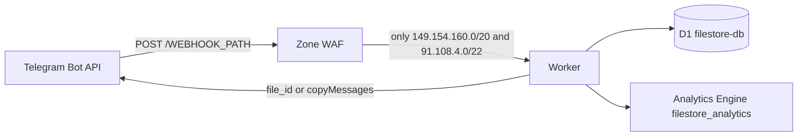

# Overview and architecture

::: warning Error 1027
When the daily request cap is gone, Cloudflare answers at the edge. The Worker does not run and cannot return HTTP 200, so Telegram retries into the next UTC day. Clear the queue from [Webhook and edge hardening](/cloudflare-filestore/webhook).
:::

One Worker (`telegram-filestore-bot`) receives Telegram updates, reads and writes a single D1 database (`filestore-db`), and emits counters to the Analytics Engine dataset `filestore_analytics`. Files never pass through the Worker. Delivery uses Telegram `file_id`, or `copyMessages` from a storage channel when `STORAGE_CHANNEL_ID` is set.



### Free-tier ceilings the bot is built around

Reset is 00:00 UTC. These are account-wide.

| Resource | Free ceiling | How this bot spends it |
|---|---|---|
| Worker requests | 100,000 / day | Each webhook update and each cron tick. The `* * * * *` trigger alone is 1,440 requests/day. |
| Worker CPU | 10 ms synchronous CPU per request (error 1102) | Await time on Telegram and D1 does not count. A multi-second delivery is legal. |
| Memory | 128 MB | No file buffers. |
| External subrequests | 50 / invocation | Bot API budget inside the code is 35. |
| Simultaneous outgoing connections | 6 | Force-join checks run in waves of at most 6. |
| Script size / startup | 64 MiB uncompressed, startup under 1 s | Cold start skips `getMe` (below). |
| D1 rows read | 5,000,000 / day | **Rows scanned, not rows returned.** |
| D1 rows written | 100,000 / day | One bundle is one row. |
| D1 storage | 5 GB | |
| Analytics Engine writes | 100,000 data points / day | Download counters and rare error signals. |

When the request cap is exceeded, Cloudflare returns **error 1027 at the edge**. The Worker does not run, so it cannot answer Telegram with HTTP 200. Telegram then retries for hours and can burn the next UTC day. The operator action is in [Webhook registration](/cloudflare-filestore/webhook): `drop_pending_updates`, or remove the webhook, until 00:00 UTC.

`[observability]` in `wrangler.toml` stays commented out. Workers Logs and traces are not required and are left off so they are not turned on by a deploy.

### Single-row JSON, and the 96% write cut

`bundles` is one row per share code. Metadata for up to **25** files lives in the `items` TEXT column as a JSON array (`file_id`, `file_unique_id`, `type`, optional name, size, mime, `storage_message_id`). There is no `bundle_items` table and no `bundles.id`.

A 25-file bundle is **one** D1 write instead of 25 child-row writes. That is `1 − 1/25 = 96%` fewer item writes than a one-row-per-file model, at the maximum size the bot accepts. Edits of an existing bundle are still one write (the CAS below), not one write per file. Deleting a bundle is a two-statement batch, and it does **not** delete `user_downloads` (that table is the daily quota and the 7-day stats ledger; deleting it would refund quota and burn writes).

```sql
-- exact stored string, not a re-serialized parse
UPDATE bundles
SET items = ?
WHERE code = ? AND items = ?;
```

`bundles` has `created_at`, not `updated_at`. If `meta.changes` is 0, another request changed the document; the handler re-reads once or aborts. Deleting the last item deletes the bundle and its `bundle_votes` rows. It does not leave `items = '[]'`.

List, search, and stats queries do not select `bundles.items`. File counts use `json_array_length(items)`. Admin stats are cached in the isolate for 5 minutes.

### Six-socket pool

The platform allows 6 outgoing connections in flight per invocation. `Promise.all` over more than 6 `getChatMember` calls is not safe: extra sockets are not queued reliably. Force-join membership checks therefore run in waves of at most 6, and they fail closed on HTTP 429, timeout, or a transport error. Those calls count toward the 35 Bot API subrequest budget. The bot does not send an owner or log-channel alert from inside a user's membership check.

Delivery of mixed file types by `file_id` is sequential (one socket). `copyMessages` / `deleteMessages` are used when a storage channel or the deletion queue can address the messages in bulk.

### Cold start without `getMe`

There is **no `BOT_ID` secret**. On each isolate, `botIdFromToken()` in `src/shared/formatters.ts` reads the numeric id with `/^(\d+):/` from `BOT_TOKEN`. It does not split the token and it does not log it.

When that id and `BOT_USERNAME` are both present, `src/bot.ts` constructs grammY with a static `botInfo` (`id`, `username`, `first_name`, and the flags in `DEFAULT_BOT_INFO`). `isInited()` is then already true, so the webhook path does not call `getMe`. If either value is missing, grammY falls back to `init()`, which is an extra subrequest on the cold isolate. Set `BOT_USERNAME`.

### Roles, quotas, webhook contract

One D1 role per user: `owner`, `superadmin`, or `admin`. `MAX_ADMINS` (10) counts only `role = 'admin'`. The numeric `OWNER_ID` is always the owner, even before the seed row exists.

| Role | Daily cap | Per-link cap |
|---|---|---|
| Owner | none (no ledger row) | none |
| Admin | 150 | 20 |
| VIP, unexpired | `daily_download_limit × 5` | `file_daily_limit × 3` |
| Everyone else | `daily_download_limit` (default 10) | `file_daily_limit` (default 3) |

Dates are UTC `YYYY-MM-DD`. The SQL triggers `trg_user_downloads_limit_insert` / `_update` are the backstop for ordinary users (default 10/day) and they **exempt** rows in `admins` and unexpired `vips`. Admin and VIP numbers above are enforced in the application before the insert.

Wrong path or non-POST: **404**. Wrong `X-Telegram-Bot-Api-Secret-Token`: **403**. Handled updates, including errors the bot has classified: **200**, so Telegram does not retry into a dead database.

---
