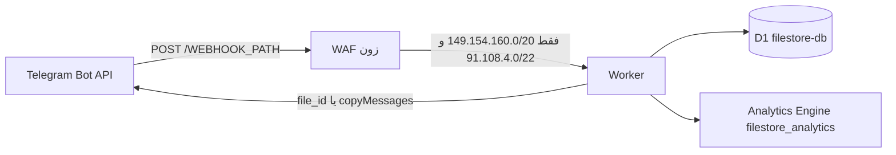

# معرفی و معماری

::: warning خطای ۱۰۲۷
اگر سقف روزانه تمام شود، کلودفلر لبه‌ای جواب می‌دهد. Worker اجرا نمی‌شود و نمی‌تواند ۲۰۰ بدهد، پس تلگرام تا روز UTC بعد دوباره می‌فرستد. صف را از [وب‌هوک و سخت‌سازی لبه](/fa/cloudflare-filestore/webhook) خالی کنید.
:::

یک Worker به نام `telegram-filestore-bot` آپدیت‌های تلگرام را می‌گیرد، فقط با یک پایگاه D1 به نام `filestore-db` کار می‌کند، و شمارنده‌ها را به مجموعهٔ Analytics Engine با نام `filestore_analytics` می‌فرستد. فایل از Worker رد نمی‌شود. تحویل یا با `file_id` تلگرام است، یا اگر `STORAGE_CHANNEL_ID` تنظیم شده باشد با `copyMessages` از کانال بایگانی.



### سقف پلن رایگان

بازنشانی سهمیه ساعت ۰۰:۰۰ به وقت UTC است و این عددها برای کل حساب‌اند، نه فقط این ربات.

| منبع | سقف رایگان | خرج این ربات |
|---|---|---|
| درخواست Worker | ۱۰۰٬۰۰۰ در روز | هر آپدیت وب‌هوک و هر تیک cron. تریگر `* * * * *` به‌تنهایی ۱۴۴۰ درخواست در روز است. |
| CPU | ۱۰ میلی‌ثانیه CPU همگام در هر درخواست (خطای ۱۱۰۲) | زمان انتظار برای تلگرام و D1 جزو این بودجه نیست. تحویل چندثانیه‌ای مجاز است. |
| حافظه | ۱۲۸ مگابایت | بافر فایل ساخته نمی‌شود. |
| زیردرخواست خارجی | ۵۰ در هر فراخوانی | بودجهٔ Bot API داخل کد ۳۵ است. |
| اتصال خروجی همزمان | ۶ | بررسی عضویت اجباری در موج‌های حداکثر ۶تایی. |
| حجم اسکریپت / استارت | ۶۴ مبی‌بایت غیرفشرده، استارت زیر ۱ ثانیه | استارت سرد `getMe` نمی‌زند (پایین‌تر). |
| ردیف خوانده‌شدهٔ D1 | ۵٬۰۰۰٬۰۰۰ در روز | **ردیف اسکن‌شده، نه ردیف برگشتی.** |
| ردیف نوشته‌شدهٔ D1 | ۱۰۰٬۰۰۰ در روز | هر بسته یک ردیف است. |
| فضای D1 | ۵ گیگابایت | |
| نوشتن Analytics Engine | ۱۰۰٬۰۰۰ نقطه در روز | شمارندهٔ دانلود و سیگنال خطای نادر. |

اگر سقف درخواست پر شود، کلودفلر **خطای ۱۰۲۷ را لبه‌ای** برمی‌گرداند. Worker اصلاً اجرا نمی‌شود و نمی‌تواند به تلگرام ۲۰۰ بدهد. تلگرام ساعت‌ها دوباره می‌فرستد و می‌تواند روز UTC بعد را هم بسوزاند. کار اپراتور در بخش [ثبت وب‌هوک](/fa/cloudflare-filestore/webhook) است: `drop_pending_updates`، یا برداشتن وب‌هوک، تا ۰۰:۰۰ UTC.

بلوک `[observability]` در `wrangler.toml` کامنت می‌ماند. لاگ و تریس Workers لازم نیست و نباید با دیپلوی روشن شود.

### یک ردیف JSON، و کاهش ۹۶ درصدی نوشتن

`bundles` برای هر کد اشتراک یک ردیف است. فرادادهٔ حداکثر **۲۵** فایل داخل ستون متنی `items` به شکل آرایهٔ JSON است (`file_id`، `file_unique_id`، `type`، و در صورت وجود نام، اندازه، mime، و `storage_message_id`). جدول `bundle_items` و ستون `bundles.id` وجود ندارد.

یک بستهٔ ۲۵فایلی **یک** نوشتن D1 است، نه ۲۵ نوشتن ردیف فرزند. یعنی `1 − 1/25 = 96%` نوشتن کمتر نسبت به مدل «هر فایل یک ردیف»، در بزرگ‌ترین اندازه‌ای که ربات می‌پذیرد. ویرایش بستهٔ موجود هم هنوز یک نوشتن است (CAS پایین)، نه یک نوشتن به‌ازای هر فایل. حذف بسته یک batch دوستوری است و `user_downloads` را پاک **نمی‌کند**. آن جدول دفتر سهمیهٔ روزانه و آمار ۷روزه است؛ پاک کردنش سهمیه را پس می‌دهد و بودجهٔ نوشتن را هدر می‌دهد.

```sql
-- دقیقاً همان رشتهٔ ذخیره‌شده، نه JSON که دوباره سریال شده باشد
UPDATE bundles
SET items = ?
WHERE code = ? AND items = ?;
```

`bundles` ستون `created_at` دارد، نه `updated_at`. اگر `meta.changes` صفر باشد، درخواست دیگری سند را عوض کرده؛ هندلر یک‌بار دوباره می‌خواند یا متوقف می‌شود. با حذف آخرین فایل، خود بسته و ردیف‌های `bundle_votes` آن حذف می‌شوند. `items = '[]'` باقی نمی‌ماند.

فهرست، جست‌وجو، و آمار ستون `bundles.items` را انتخاب نمی‌کنند. تعداد فایل با `json_array_length(items)` است. آمار مدیر ۵ دقیقه در همان isolate کش می‌شود.

### استخر شش سوکت

سکو در هر فراخوانی فقط ۶ اتصال خروجی همزمان اجازه می‌دهد. `Promise.all` روی بیش از ۶ تا `getChatMember` امن نیست؛ سوکت اضافه قابل‌اتکا صف نمی‌شود. بررسی عضویت کانال‌های جوین اجباری در موج‌های حداکثر ۶تایی اجرا می‌شود و روی ۴۲۹، تایم‌اوت، یا خطای شبکه بسته می‌ماند (کاربر «عضو نشده» فرض می‌شود و موج بعدی نمی‌رود). این تماس‌ها جزو بودجهٔ ۳۵تایی Bot API هستند. از داخل درخواست تأیید کاربر، به مالک یا کانال لاگ هشدار فرستاده نمی‌شود.

تحویل نوع‌های مختلف با `file_id` ترتیبی است (یک سوکت). `copyMessages` و `deleteMessages` فقط وقتی استفاده می‌شوند که کانال بایگانی یا صف حذف بتواند شناسهٔ پیام‌ها را یکجا بفرستد.

### استارت سرد بدون `getMe`

راز `BOT_ID` وجود **ندارد**. در هر isolate تابع `botIdFromToken()` در `src/shared/formatters.ts` شناسهٔ عددی را با عبارت `/^(\d+):/` از `BOT_TOKEN` می‌خواند. توکن را `split` نمی‌کند و لاگ هم نمی‌کند.

اگر هم این شناسه باشد و هم `BOT_USERNAME`، `src/bot.ts` کتابخانهٔ grammY را با `botInfo` ایستا می‌سازد (`id`، `username`، `first_name`، و پرچم‌های `DEFAULT_BOT_INFO`). در این حالت `isInited()` از همان اول درست است و مسیر وب‌هوک `getMe` نمی‌زند. اگر یکی از این دو نباشد، grammY به `init()` برمی‌گردد و روی isolate سرد یک زیردرخواست اضافه می‌شود. `BOT_USERNAME` را بگذارید.

### نقش، سهمیه، قرارداد وب‌هوک

هر کاربر در D1 فقط یک نقش دارد: `owner`، `superadmin`، یا `admin`. `MAX_ADMINS` (۱۰) فقط ردیف‌های `role = 'admin'` را می‌شمارد. شناسهٔ عددی `OWNER_ID` همیشه مالک است، حتی پیش از ساخته شدن ردیف.

| نقش | سقف روزانه | سقف هر لینک |
|---|---|---|
| مالک | هیچ (ردیف دفتر نوشته نمی‌شود) | هیچ |
| مدیر | ۱۵۰ | ۲۰ |
| ویژه، منقضی‌نشده | `daily_download_limit × ۵` | `file_daily_limit × ۳` |
| بقیه | `daily_download_limit` (پیش‌فرض ۱۰) | `file_daily_limit` (پیش‌فرض ۳) |

تاریخ‌ها `YYYY-MM-DD` به وقت UTC هستند. تریگرهای `trg_user_downloads_limit_insert` و `_update` ترمز کاربر عادی‌اند (پیش‌فرض ۱۰ در روز) و ردیف‌های `admins` و VIP منقضی‌نشده را **معاف** می‌کنند. عددهای مدیر و VIP در جدول بالا قبل از درج، در خود برنامه اعمال می‌شوند.

مسیر اشتباه یا متد غیر از POST: **۴۰۴**. مقدار اشتباه هدر `X-Telegram-Bot-Api-Secret-Token`: **۴۰۳**. آپدیت رسیدگی‌شده، از جمله خطایی که ربات طبقه‌بندی کرده: **۲۰۰**، تا تلگرام همان آپدیت را به پایگاه ازکارافتاده شلیک نکند.

---
