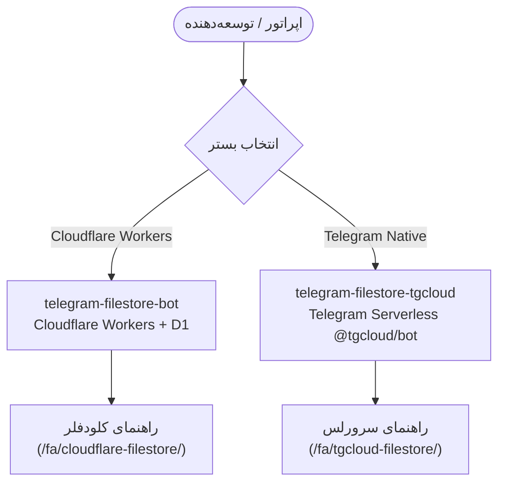

## پرتال جامع مستندات فایل‌استور

به پایگاه مستندات یکپارچهٔ اکوسیستم **ربات‌های فایل‌استور تلگرام** خوش آمدید. هر دو نسخه از یک فلسفهٔ واحد پیروی می‌کنند: **۱۰۰٪ رایگان برای همیشه**، بدون نیاز به سرور اختصاصی و بدون عبور بایت‌های فایل از سرور.

### انتخاب بستر استقرار

- **[راهنمای نسخه Cloudflare Workers](/fa/cloudflare-filestore/architecture):** طراحی‌شده برای لبه کلودفلر و پایگاه داده D1، همراه با پایپ‌لاین خودکار استقرار در GitHub Actions.
- **[راهنمای نسخه Telegram Serverless](/fa/tgcloud-filestore/architecture):** طراحی‌شده برای پلتفرم رسمی `@tgcloud/bot` تلگرام بدون هیچ وابستگی زمان اجرا و استفاده از دیتابیس درون‌برنامه‌ای.
