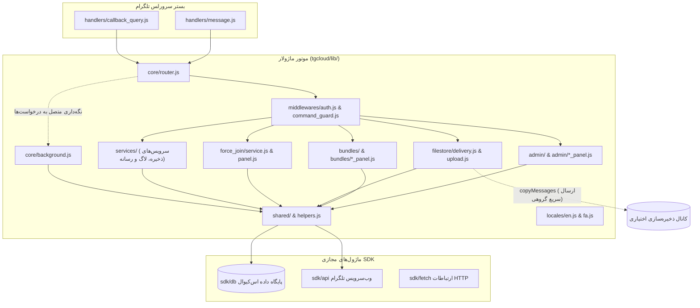

# معرفی و معماری

ربات ذخیره و اشتراک‌گذاری فایل تلگرام در سطح سازمانی و پایدار، طراحی‌شده به‌طور اختصاصی برای **بستر سرورلس بومی تلگرام (`@tgcloud/bot`)**. نسخه **۱.۰.۰**.

::: tip فلسفه ۱۰۰٪ رایگان برای همیشه
این نسخه کاملاً بر بستر رسمی سرورلس تلگرام اجرا می‌شود. هیچ نیازی به سرور اختصاصی (VPS)، هاست ابری جانبی و پوشهٔ حجیم `node_modules` در زمان اجرا وجود ندارد.
:::

---

## ساختار معماری

کد ربات درون میکروایزوله‌های بومی تلگرام اجرا می‌شود. به جای اجرای یک وب‌سرور دائم یا ورکر جداگانه، رویدادهای ارسالی تلگرام مستقیماً به هندلرهای مسطح ارسال شده و از طریق موتور هسته ماژولار هدایت می‌شوند.



---

## معماری بدون وابستگی اجرایی (Zero-Dependency)

برخلاف برنامه‌های متداول Node.js که نیازمند بارگذاری صدها مگابایت وابستگی خارجی هستند، این ربات در زمان اجرا **بدون هرگونه پکیج npm** عمل می‌کند:

1. **ماژول‌های مجازی SDK:** کلیه ارتباطات خارجی و ذخیره‌سازی از طریق ماژول‌های مجازی تعبیه‌شده در سیستم صورت می‌گیرد:
   - `'sdk/db'`: ارائه‌دهنده ساختار ORM و DSL اس‌کیو‌ال SQLite (`table`, `integer`, `text`, `index`).
   - `'sdk/api'`: کلاینت رسمی و مستقیم Bot API تلگرام که آبجکت‌های snake_case می‌پذیرد (`api.sendMessage({ chat_id, text })`).
   - `'sdk/fetch'`: کلاینت متنی HTTP با سقف پاسخ ۳۰ مگابایت.
2. **هندلرهای تخت:** رویدادها مستقیماً توسط دو فایل مسطح درون `handlers/` دریافت می‌شوند:
   - `handlers/message.js`: مدیریت دستورات متنی (`/start`, `/batch`, `/done`, `/manage`, `/stats`) و هدایت آپلود فایل‌ها به `core/router.js`.
   - `handlers/callback_query.js`: مدیریت دکمه‌های شیشه‌ای (صفحه‌بندی، ثبت رأی، تأیید حذف و تنظیمات تعاملی).
3. **ساختار ماژولار کتابخانه (`tgcloud/lib/`):**
   - `tgcloud/lib/shared/`: ابزارهای پایه (`crypto.js` برای تولید توکن‌های امن وب‌کریپتو و هش، `formatters.js` برای اسکیپ امن HTML و قالب‌بندی حجم، `buttons.js` برای ساخت کیبوردها، `emojis.js` برای رندر اموجی‌های سفارشی و مدارشکن خودکار).
   - `tgcloud/lib/middlewares/`: دروازه‌بان‌های سیستم (`auth.js` برای اعتبارسنجی نقش‌ها و سطوح دسترسی، `command_guard.js` برای محدودیت نرخ درخواست و حالت تعمیرات، `rate_limiter.js`، و ماژول‌های کنترل دسترسی در `roles/`: `roles/admin.js` برای بررسی دسترسی سطح ۲ ادمین، `roles/public.js` برای بررسی دسترسی کاربران عمومی و محدودیت نرخ، `roles/super_admin.js` برای بررسی دسترسی سطح ۳ ابرمدیر، و `roles/owner.js` برای بررسی دسترسی سطح ۴ مالک).
   - `tgcloud/lib/admin/`: مدیریت عملیاتی ربات (`index.js`، `admins.js` برای منطق اعطا، لغو و فهرست‌بندی نقش‌های ادمین، `factory_reset.js` برای رویه‌های اتمیک بازنشانی کارخانه و خالی‌کردن جداول، `owner.js` برای دستور راه‌اندازی مالک `/setbotowner`/`/ermia`، `members.js`، `members_panel.js`، `settings.js`، `settings_panel.js`، `profile.js`، `profile_panel.js`، `stats.js`، `maintenance.js`، و `helpers.js`).
   - `tgcloud/lib/bundles/`: مدیریت چرخه حیات بسته‌ها (`index.js`، `permissions.js` برای قفل مالکیتی، `hub_panel.js`، `review_panel.js`، `protected.js`، `pin.js`، `expiry.js`، `rotation.js`، `deletion.js`، `setname.js`).
   - `tgcloud/lib/filestore/`: توزیع و تحویل محتوا (`delivery.js` برای ارسال چندبخشی تا ۲۵ آیتم، `unlock.js` برای احراز رمز عبور، `upload.js` برای آپلود تکی و گروهی، `voting.js`، `search.js`).
   - `tgcloud/lib/force_join/`: پایپ‌لاین اعتبارسنجی عضویت (`panel.js`، `service.js` تا سقف ۸ کانال در دسته‌های ۶تایی، `handlers.js`، `wizards.js`).
   - `tgcloud/lib/services/`: سرویس‌های سیستمی (`storage_channel.js` برای همگام‌سازی کانال ذخیره‌سازی، `log_channel.js` برای ثبت رویدادها و لاگ‌های امنیتی، `media_config.js` برای تنظیم انواع رسانه‌های مجاز).
   - `tgcloud/lib/core/`: هماهنگی موتور مرکزی (`router.js` برای توزیع یکپارچه رویدادها، `background.js` برای پاس‌های نگه‌داری فرصت‌طلبانه).
   - `tgcloud/lib/locales/`: محلی‌سازی و زبان‌ها (`en.js`، `fa.js`، `index.js` با تطابق ۱۰۰٪ توکن‌ها و کلیدها در تمام ۲۶۵ کلید ترجمه).
   - `tgcloud/lib/helpers.js`: توابع مشترک پایگاه داده، فراخوانی‌های تلگرام با مدارشکن اموجی و ابزارهای DRY (`sendMsg`، `editMsg`، `editMarkup`، `answerCq`، `setAdminPrompt`، `clearAdminSession`، `clearUserSession`، `getBundle`، `parseItems`، `nowSec`).

### ساختار درختی ماژول‌های معماری

```
tgcloud/
├── schema.js               # تعریف ساختار پایگاه داده (۱۱ جدول)
├── handlers/
│   ├── message.js          # هدایت دستورات متنی و آپلود فایل‌ها به مسیریاب اصلی
│   └── callback_query.js   # مدیریت کلیک دکمه‌های شیشه‌ای همراه با پاسخ‌دهی آنی
└── lib/
    ├── helpers.js          # توابع مشترک پایگاه داده و متدهای ارتباط با وب‌سرویس تلگرام
    ├── admin/
    │   ├── admins.js         # منطق اعطا، لغو و فهرست‌بندی نقش‌های ادمین
    │   ├── factory_reset.js  # رویه‌های اتمیک بازنشانی کارخانه و خالی‌کردن جداول
    │   ├── helpers.js        # ابزارها و نشست‌های تعاملی مدیریت
    │   ├── index.js          # توزیع‌کننده دستورات و منوهای مدیریتی
    │   ├── maintenance.js    # کنترل حالت نگهداری اختصاصی مالک
    │   ├── members.js        # فهرست کارکنان و ترفیع/تنزل مدیران و VIP
    │   ├── members_panel.js  # کیبوردهای شیشه‌ای مدیریت کارکنان
    │   ├── owner.js          # راه‌اندازی و انتقال مالکیت اصلی (/setbotowner, /ermia)
    │   ├── profile.js        # ماشین حالت ویرایش پروفایل ربات (نام، درباره، توضیحات)
    │   ├── profile_panel.js  # کیبوردهای تنظیمات پروفایل ربات
    │   ├── settings.js       # مدیریت تنظیمات سیستم (سهمیه‌ها، زمان‌ها، محافظت‌ها)
    │   ├── settings_panel.js # پنل رابط کاربری شیشه‌ای تنظیمات سیستم
    │   ├── sql_console.js    # کنسول تعاملی اجرای کوئری اس‌کیو‌ال برای مالک
    │   └── stats.js          # تحلیل و محاسبات آماری دانلودها
    ├── bundles/
    │   ├── deletion.js       # حذف آبشاری بسته‌ها و پاک‌سازی وابستگی‌ها
    │   ├── expiry.js         # محاسبه زمان انقضا و پاک‌سازی خودکار بسته‌ها
    │   ├── hub_panel.js      # پنل تعاملی هاب مدیریت بسته و دکمه‌های عملیاتی
    │   ├── index.js          # مسیریاب و نقطه ورود بخش بسته‌ها
    │   ├── permissions.js    # گارد دسترسی و قفل مالکیتی بسته‌ها
    │   ├── pin.js            # اعتبارسنجی پین‌کد و بررسی هش PBKDF2/SHA-256
    │   ├── protected.js      # حفاظت با پین‌کد، هشینگ و مدیریت قفل
    │   ├── review_panel.js   # رابط کاربری بررسی و حذف انتخابی فایل‌های بسته
    │   ├── rotation.js       # چرخش زمان‌بندی‌شده پیوندها و به‌روزرسانی پست کانال
    │   └── setname.js        # فرآیند تعاملی تغییر نام بسته
    ├── core/
    │   ├── background.js     # اجرای نگهداری و پاک‌سازی بهینه پس‌زمینه
    │   └── router.js         # مسیریاب مرکزی پیام‌ها و دکمه‌های شیشه‌ای
    ├── filestore/
    │   ├── delivery.js       # تحویل چندمرحله‌ای فایل‌ها (تا ۲۵ فایل) با صفحه‌بندی
    │   ├── search.js         # جستجوی بسته‌ها بر اساس عنوان
    │   ├── unlock.js         # اعتبارسنجی رمز عبور و مجوز دانلود
    │   ├── upload.js         # خط لوله آپلود تکی و چندتایی (/batch)
    │   └── voting.js         # ثبت و مدیریت آرای مثبت و منفی کاربران
    ├── force_join/
    │   ├── handlers.js       # هندلرهای دستورات و دکمه‌های جوین اجباری
    │   ├── panel.js          # پنل مدیریت کانال‌های اجباری و فهرست آن‌ها
    │   ├── service.js        # سرویس بررسی عضویت چندکاناله (تا ۸ کانال)
    │   └── wizards.js        # ویزاردهای افزودن کانال و برچسب دکمه
    ├── locales/
    │   ├── en.js             # دیکشنری محلی انگلیسی (۲۶۵ کلید)
    │   ├── fa.js             # دیکشنری محلی فارسی (جداسازی طبق قانون ۱۴، ۲۶۵ کلید)
    │   └── index.js          # متصل‌کننده پویا و قالب‌بندی متون محلی
    ├── middlewares/
    │   ├── auth.js           # گارد احراز هویت و تعیین سطوح دسترسی نقش‌ها
    │   ├── command_guard.js  # محدودکننده نرخ پیام‌ها و گارد نگهداری
    │   ├── rate_limiter.js   # محدودکننده نرخ لغزان و ثبت اخطارهای سوءاستفاده
    │   └── roles/
    │       ├── admin.js      # بررسی دسترسی سطح ۲ ادمین
    │       ├── owner.js      # بررسی دسترسی سطح ۴ مالک
    │       ├── public.js     # بررسی دسترسی کاربران عمومی و محدودیت نرخ
    │       └── super_admin.js# بررسی دسترسی سطح ۳ ابرمدیر و کنترل دسترسی اداری
    ├── services/
    │   ├── log_channel.js    # سرویس ارسال لاگ‌های امنیتی و رویدادها
    │   ├── media_config.js   # پیکربندی پویا و تغییر انواع رسانه‌های مجاز
    │   └── storage_channel.js# سرویس پشتیبان‌گیری و همگام‌سازی کانال ذخیره‌سازی
    └── shared/
        ├── buttons.js        # سازنده کیبوردهای شیشه‌ای تلگرام
        ├── config.js         # کش درون حافظه‌ای تنظیمات سیستم (system_config)
        ├── constants.js      # مقادیر پیش‌فرض، سقف‌ها و زمان‌های انقضا
        ├── crypto.js         # تولید شناسه‌های امن، هشینگ و توابع Web Crypto
        ├── emojis.js         # رندر اموجی‌های سفارشی و مدارشکن خودکار
        ├── formatters.js     # پاک‌سازی و فرار دادن HTML و قالب‌بندی متون
        ├── sessions.js       # مدیریت ماشین حالت نشست‌ها و درخواست‌های ورودی
        └── telegram.js       # توابع سطح پایین تعامل با وب‌سرویس تلگرام
```

4. **توزیع تک‌فایلی مستقل:** پشتیبانی از هر دو حالت توزیع ماژولار برای `@tgcloud/cli` و فایل ادغام‌شده مستقل `dist/single-file-core.js` با دیکشنری‌های دوزبانه درون‌خطی برای قرار دادن مستقیم در رابط وب BotFather.

---

## مدل پایداری و سند JSON تک‌ردیفه

لایه داده در **۱۱ جدول اختصاصی** در فایل `schema.js` تعریف شده است. بسته‌های فایل بر اساس **مدل سند JSON تک‌ردیفه** ذخیره می‌شوند:

- تمام آیتم‌های فایل یک بسته (تا سقف ۲۵ فایل) درون یک آرایه JSON در ستون `bundles.items` قرار می‌گیرند.
- هر آیتم شامل اطلاعات `file_id`، `file_unique_id`، `type`، نام اختیاری، اندازه، نوع فایل و `storage_message_id` است.
- **هیچ جدول رابطه‌ای مجزایی مانند `bundle_items` وجود ندارد.** ذخیره ۲۵ فایل در یک ردیف باعث **۹۶٪ کاهش در عملیات نوشتن** نسبت به مدل‌های رابطه‌ای می‌شود.
- تمام به‌روزرسانی‌های ستون `bundles.items` با الگوی اتمیک **Compare-And-Swap (CAS)** انجام می‌پذیرد.

```sql
-- ویرایش اتمیک با Compare-And-Swap (CAS)
UPDATE bundles
SET items = ?
WHERE code = ? AND items = ?;
```

### خلاصه جداول پایگاه داده (۱۱ جدول)

| جدول | کاربرد | استراتژی نوشتن |
|---|---|---|
| `bundles` | شناسه بسته، آرایه JSON فایل‌ها، قفل‌ها، رمزها (هش‌های مقاوم در برابر چرخش `v2`)، فواصل چرخش و قوانین انقضا | درج تکی؛ به‌روزرسانی اتمیک با CAS |
| `admin_sessions` | بافر موقت آپلود گروهی فایل‌ها (`MAX_PER_SESSION_UPLOAD = 20`) و وضعیت پیام‌های ورودی ادمین | درج/به‌روزرسانی با دریافت فایل یا اعلان؛ پاک‌سازی با `/done` یا `/cancel` |
| `user_sessions` | وضعیت نشست‌های تعاملی کاربران عادی (ورود رمز با `ForceReply` و خروج با `/cancel`) | درج/به‌روزرسانی هنگام چالش رمز؛ پاک‌سازی پس از موفقیت یا `/cancel` |
| `system_config` | تنظیمات زنده سیستم بدون متغیر محیطی (Zero-Env) مانند سقف دانلود روزانه و کانال ذخیره‌سازی | کش میکرو درون‌حافظه‌ای با TTL ۶۰ ثانیه؛ به‌روزرسانی با `setConfig` |
| `admins` | ثبت نقش‌های دسترسی ادمین (`owner`, `superadmin`, `admin`) | کش میکرو درون‌حافظه‌ای با TTL ۶۰ ثانیه؛ حداکثر ۱۰ ادمین عادی |
| `vips` | کاربران ویژه با دانلود نامحدود و معافیت از جوین اجباری | خواندن نقطه‌ای با `user_id` |
| `force_channels` | کانال‌های ثبت‌شده برای عضویت اجباری | محدود به حداکثر ۸ کانال فعال (`MAX_FORCE_JOIN_CHANNELS = 8`) |
| `user_quotas` | ثبت اخطارها و مسدودسازی کاربران متخلف | به‌روزرسانی تکی؛ کش ۶۰ ثانیه‌ای |
| `user_downloads` | دفتر کل سهمیه روزانه و آمار ۷ روزه دانلودها (ستون `code`) | ثبت اتمیک سهمیه هر بسته؛ پاک‌سازی هفتگی |
| `bundle_votes` | آرای مثبت و منفی کاربران برای هر بسته | یک ردیف به ازای هر `(code, user_id)` |
| `deletion_queue` | صف زمان‌بندی‌شده حذف خودکار فایل‌های تحویل‌شده | درج در صورت فعال بودن حذف خودکار؛ پاک‌سازی هنگامی که `delete_at <= now` |

---

## جریان فایل‌ها و عدم عبور بایت‌ها از ربات

بایت‌های داده **هرگز درون حافظه ربات دانلود یا ذخیره موقت نمی‌شوند**:
- تحویل بسته‌ها بر اساس ارسال ترتیبی با شناسه مستقیم `file_id` صورت می‌گیرد.
- در صورت تنظیم کانال ذخیره‌سازی (`STORAGE_CHANNEL_ID` در `system_config`)، فایل‌ها یک‌بار با `copyMessage` ذخیره شده و تحویل نهایی به کاربران با دستور سریع و دسته‌جمعی `copyMessages` انجام می‌شود.
- فایل‌های باینری هرگز درون حافظه خوانده نمی‌شوند و در نتیجه مصرف منابع همواره زیر سقف رایگان پلتفرم حفظ می‌گردد.

---

## کنترل اتصالات همزمان و شبکه

1. **سقف اتصالات خروجی همزمان:** حداکثر **۶** درخواست خروجی همزمان در هر لحظه مجاز است. بررسی عضویت کانال‌های جوین اجباری (`getChatMember`) در امواج ۶تایی میان حداکثر ۸ کانال فعال انجام می‌شود.
2. **سقف درخواست‌های خارجی:** فراخوانی متدهای تلگرام کاملاً بهینه شده و در صورت امکان از متدهای گروهی (`deleteMessages`, `copyMessages`) استفاده می‌شود.
3. **مدیریت خطای ۴۲۹ (FloodWait):** در صورت دریافت خطای محدودیت تلگرام، حلقه ارسال فوراً متوقف شده و با خواندن پارامتر `retry_after` از ارسال درخواست‌های بیشتر جلوگیری می‌گردد.
4. **بررسی کاملاً غیرفعال عضویت در کانال‌ها (Passive Force-Join):** اعتبارسنجی عضویت در کانال‌ها کاملاً غیرفعال و از طریق `getChatMember` صورت می‌گیرد. ربات در فرآیند بررسی عضویت هیچ‌گونه تغییری در لینک‌های دعوت یا جهش API ایجاد نمی‌کند؛ این امر ریسک خطای محدودیت ۴۲۹ تلگرام را کاملاً از بین برده و مانع از هدررفت منابع می‌شود.

---

## نگه‌داری دوره‌ای متصل به رویدادها (Piggybacked Maintenance)

از آنجا که پلتفرم سرورلس تلگرام فاقد زمان‌بندی‌های مستقل cron است، وظایف دوره‌ای پاک‌سازی به‌صورت **متصل و هم‌گام** با رویدادهای دریافتی اجرا می‌شوند (`runOpportunisticMaintenance` در `lib/core/background.js`):

- **پاک‌سازی صف حذف:** حذف پیام‌های فایل تحویل‌شده که زمان انقضای آن‌ها فرا رسیده است (`delete_at <= now`، تا سقف ۲۵ آیتم در هر نوبت).
- **حذف بسته‌های یک‌بار مصرف رهاشده:** بسته‌های تک‌کاربره که بیش از ۱۵ دقیقه از اولین دانلود آنها گذشته و فرایند تکمیل نشده است، حذف می‌شوند (تا سقف ۱۰ بسته در هر نوبت).
- **چرخش زمان‌بندی‌شده لینک‌ها:** بررسی بسته‌های زمان‌دار (`last_rotated_at + rotate_interval_sec <= now`، تا سقف ۵ بسته در هر نوبت) و به‌روزرسانی خودکار دکمه پست کانال با شناسه جدید.
- **پاک‌سازی گزارش سهمیه‌ها:** حذف رکوردهای سهمیه دانلود قدیمی‌تر از ۷ روز (تا سقف ۲۵ رکورد در هر نوبت).

### محافظت در برابر اجرای موازی با الگوی اتمیک Compare-And-Swap (CAS)

جهت جلوگیری از اجرای تکراری عملیات نگه‌داری در هنگام دریافت هم‌زمان چندین پیام در میکروایزوله‌های موازی، تابع `runOpportunisticMaintenance` از یک گارد اتمیک **Compare-And-Swap (CAS)** روی شناسه زمانی `last_maint_at` در جدول `system_config` استفاده می‌کند:

```sql
-- گارد اجرای اتمیک CAS روی last_maint_at
UPDATE system_config
SET value = ?
WHERE key = 'last_maint_at' AND value = ?;
```

تنها ایزوله‌ای که موفق به تغییر اتمیک مقدار `last_maint_at` شود، مجوز اجرای عملیات را دریافت می‌کند. سایر ایزوله‌های موازی با شکست شرط CAS فوراً از اجرای عملیات صرف‌نظر می‌کنند؛ در نتیجه از اجرای تکراری صف حذف، چرخش لینک‌ها و پاک‌سازی سهمیه‌ها در ایزوله‌های موازی جلوگیری به عمل می‌آید.

---

## کش میکرو درون‌حافظه‌ای و گارد حافظه محدود (In-Memory Micro-Caching & Bounded Eviction)

جهت بیشینه‌سازی سرعت و تضمین پایداری حافظه در میکروایزوله‌های سرورلس:
- **کش میکرو درون‌حافظه‌ای با TTL ۶۰ ثانیه:** خواندن‌های با بسامد بالا برای توابع `getConfig()` و `getAdmins()` به مدت ۶۰ ثانیه در رم ایزوله کش می‌شوند. این تدبیر کوئری‌های تکراری خواندن از پایگاه داده را در هر پیام و کالبک ورودی کاملاً حذف کرده و هم‌زمان انتشار تغییرات پیکربندی میان ایزوله‌ها را ظرف حداکثر یک دقیقه تضمین می‌کند.
- **گارد پاک‌سازی حافظه با ظرفیت محدود (`strikeMap`):** جدول درون‌حافظه‌ای ردیابی اخطارها و محدودیت نرخ (`strikeMap` در `middlewares/rate_limiter.js`) از الگوی گارد حافظه محدود با سقف ۲۰۰۰ رکورد و پاک‌سازی خودکار LRU و انقضای زمانی بهره می‌برد. رکوردهای منقضی‌شده و نشانه‌های زمانی کهنه مرتباً پاک‌سازی می‌شوند تا ردپای مصرف حافظه درون ایزوله کاملاً مهار شده باقی بماند.
- **مسیر سریع ضد سوءاستفاده با صفر نوشتن:** پین‌کد واردشده در حافظه رم با `passcode_hash` (هش امن `v2` همراه با نمک اختصاصی بسته و SHA-256) مقایسه می‌شود. تلاش‌های ناموفق در `strikeMap` بدون مصرف نوشتن در دیتابیس ثبت شده و پس از ۵ تلاش اشتباه، کاربر به مدت ۳۰ دقیقه مسدود می‌شود.
