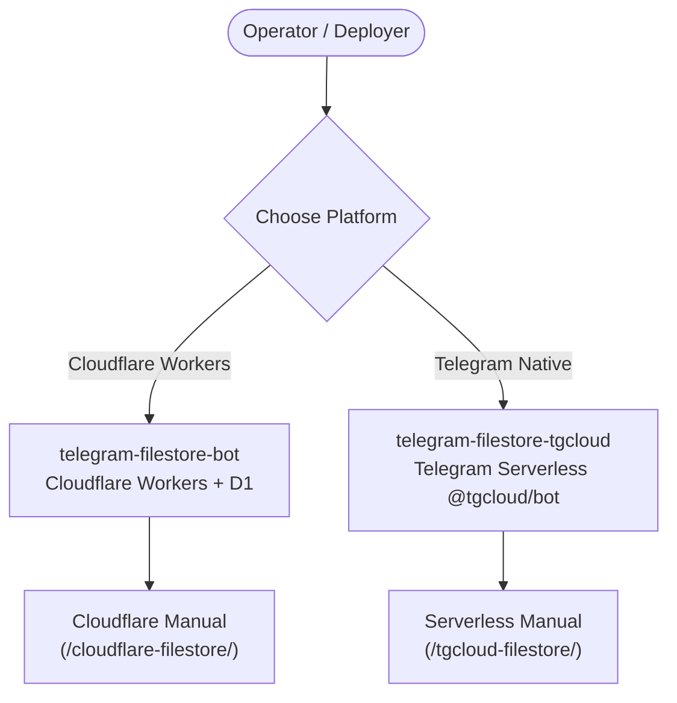

## Multi-Project Documentation Portal

Welcome to the centralized documentation hub for the **Telegram FileStore Bot** ecosystem. Both editions share the exact same core philosophy: **100% Free Forever**, zero VPS hosting fees, and zero buffering of file bytes.

### Choose Your Deployment Architecture

- **[Cloudflare Workers Edition](/cloudflare-filestore/architecture):** Engineered for Cloudflare's global edge network and D1 SQLite database. Includes full automated GitHub Actions deployment via Wrangler.
- **[Telegram Serverless Edition](/tgcloud-filestore/architecture):** Engineered for Telegram's official `@tgcloud/bot` environment with zero runtime npm dependencies and built-in database DSL.
