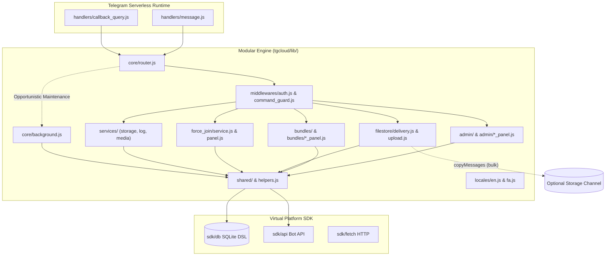

# Overview & Architecture

Production-grade Telegram FileStore bot engineered specifically for **Telegram Serverless (`@tgcloud/bot`)**. Version **1.0.0**.

::: tip 100% Free Forever Philosophy
This edition runs 100% inside Telegram's native serverless runtime. It requires zero VPS or external servers, zero external cloud hosting fees, and zero `node_modules` at runtime.
:::

---

## Architectural Topology

The bot executes inside Telegram's native micro-isolate runtime environment. Instead of hosting an external HTTP server or Worker, updates are directly routed to flat handler scripts and dispatched through the modular core engine.



---

## Zero Runtime Dependency Architecture

Unlike standard Node.js applications that deploy hundreds of megabytes of `node_modules`, this bot uses **zero npm dependencies at runtime**:

1. **Virtual SDK Modules:** All external communication and database queries rely exclusively on platform-provided virtual modules:
   - `'sdk/db'`: High-performance embedded SQLite ORM DSL (`table`, `integer`, `text`, `index`).
   - `'sdk/api'`: Native Telegram Bot API client taking snake_case objects (`api.sendMessage({ chat_id, text })`).
   - `'sdk/fetch'`: Textual HTTP fetch client (30 MB response cap).
2. **Flat Handlers:** Incoming events are captured by flat files located directly in `handlers/`:
   - `handlers/message.js`: Directs commands (`/start`, `/batch`, `/done`, `/manage`, `/stats`) and file uploads to `core/router.js`.
   - `handlers/callback_query.js`: Handles inline button interactions (pagination, voting, deletion confirmation, interactive settings).
3. **Modular Library (`tgcloud/lib/`):**
   - `tgcloud/lib/shared/`: Foundation utilities (`crypto.js` for Web Crypto tokens/salts/hashing, `formatters.js` for HTML escaping & byte formatting, `buttons.js` for keyboard builders, `emojis.js` for custom emoji renderer & self-healing circuit breaker).
   - `tgcloud/lib/middlewares/`: Gatekeepers (`auth.js` for role verification & permissions, `command_guard.js` for rate limiting & maintenance mode enforcement, `rate_limiter.js`, and role controllers in `roles/`: `roles/admin.js` for Role Level 2 permission checks, `roles/public.js` for public user permission checks and rate-limit gatekeeping, `roles/super_admin.js` for Role Level 3 permission checks and administrative access control, and `roles/owner.js` for Level 4 owner checks).
   - `tgcloud/lib/admin/`: Operational management (`index.js`, `admins.js` for admin role grant, revoke, and listing logic, `factory_reset.js` for core atomic reset procedures and table truncations, `owner.js` for `/setbotowner`/`/ermia`, `members.js`, `members_panel.js`, `settings.js`, `settings_panel.js`, `profile.js`, `profile_panel.js`, `stats.js`, `maintenance.js`, and `helpers.js`).
   - `tgcloud/lib/bundles/`: Bundle hub & lifecycle (`index.js`, `permissions.js` for owner locking, `hub_panel.js`, `review_panel.js`, `protected.js`, `pin.js`, `expiry.js`, `rotation.js`, `deletion.js`, `setname.js`).
   - `tgcloud/lib/filestore/`: Content delivery (`delivery.js` for chunked delivery up to 25 items, `unlock.js` for passcode grants, `upload.js` for single & batch uploads, `voting.js`, `search.js`).
   - `tgcloud/lib/force_join/`: Verification pipeline (`panel.js`, `service.js` for up to `MAX_FORCE_JOIN_CHANNELS = 8` in waves of 6, `handlers.js`, `wizards.js`).
   - `tgcloud/lib/services/`: System services (`storage_channel.js` for file backup mirror, `log_channel.js` for event audit logging, `media_config.js` for dynamic media type toggles).
   - `tgcloud/lib/core/`: Engine orchestration (`router.js` for unified event dispatching, `background.js` for opportunistic maintenance passes).
   - `tgcloud/lib/locales/`: Internationalization (`en.js`, `fa.js`, `index.js` with 100% token and key parity across 265 localization keys).
   - `tgcloud/lib/helpers.js`: Shared database wrappers, Telegram API calls with emoji circuit-breaker, and DRY helpers (`sendMsg`, `editMsg`, `editMarkup`, `answerCq`, `setAdminPrompt`, `clearAdminSession`, `clearUserSession`, `getBundle`, `parseItems`, `nowSec`).

### Modular Architecture Directory Tree

```
tgcloud/
├── schema.js               # Database schema definition (11 tables)
├── handlers/
│   ├── message.js          # Directs text commands and file uploads to core router
│   └── callback_query.js   # Dispatches inline button interactions with immediate ack
└── lib/
    ├── helpers.js          # Core shared database wrappers and Telegram API dispatchers
    ├── admin/
    │   ├── admins.js         # Admin role grant, revoke, and listing logic
    │   ├── factory_reset.js  # Core atomic reset procedures and table truncations
    │   ├── helpers.js        # Admin prompt utilities and session state handlers
    │   ├── index.js          # Admin command dispatcher and menu routing
    │   ├── maintenance.js    # Strict owner-only maintenance mode toggle
    │   ├── members.js        # Staff roster, admin/VIP promotion and demotion
    │   ├── members_panel.js  # Staff management inline keyboards and panels
    │   ├── owner.js          # Root ownership assignment (/setbotowner, /ermia)
    │   ├── profile.js        # Bot profile state machine (name, about, description)
    │   ├── profile_panel.js  # Bot profile configuration keyboards
    │   ├── settings.js       # System settings handlers (quotas, TTLs, protections)
    │   ├── settings_panel.js # Settings inline GUI panels
    │   ├── sql_console.js    # Interactive SQL console for system owners
    │   └── stats.js          # Analytics and download metric calculations
    ├── bundles/
    │   ├── deletion.js       # Cascading bundle deletion and cleanup
    │   ├── expiry.js         # Expiry threshold calculations and auto-purge logic
    │   ├── hub_panel.js      # Interactive Bundle Hub panel and action buttons
    │   ├── index.js          # Bundle module router and entrypoint
    │   ├── permissions.js    # Hierarchical owner-lock permission guards
    │   ├── pin.js            # PIN validation, PBKDF2/SHA-256 verification
    │   ├── protected.js      # PIN passcode protection, hashing & lock management
    │   ├── review_panel.js   # Individual item inspection and deletion GUI
    │   ├── rotation.js       # Scheduled link rotation and channel post updates
    │   └── setname.js        # Interactive bundle renaming workflow
    ├── core/
    │   ├── background.js     # Opportunistic background maintenance passes
    │   └── router.js         # Unified message and callback query router
    ├── filestore/
    │   ├── delivery.js       # Chunked file delivery (up to 25 items) with pagination
    │   ├── search.js         # Bundle search by title
    │   ├── unlock.js         # Passcode verification and unlock grants
    │   ├── upload.js         # Single and batch (/batch) file upload pipeline
    │   └── voting.js         # Community bundle upvote/downvote handling
    ├── force_join/
    │   ├── handlers.js       # Force-join command and callback query dispatchers
    │   ├── panel.js          # Force-join management GUI and channel listings
    │   ├── service.js        # Channel membership verification (up to 8 channels)
    │   └── wizards.js        # Channel addition and custom button label wizards
    ├── locales/
    │   ├── en.js             # English i18n locale dictionary (265 keys)
    │   ├── fa.js             # Persian i18n locale dictionary (Rule 14 isolated, 265 keys)
    │   └── index.js          # Dynamic locale resolver and string interpolator
    ├── middlewares/
    │   ├── auth.js           # Role authentication and authorization guards
    │   ├── command_guard.js  # Command rate-limiting and maintenance mode guard
    │   ├── rate_limiter.js   # Sliding-window rate limiter and strike tracking
    │   └── roles/
    │       ├── admin.js      # Role Level 2 permission checks
    │       ├── owner.js      # Role Level 4 permission checks
    │       ├── public.js     # Public user permission checks and rate-limit gatekeeping
    │       └── super_admin.js# Role Level 3 permission checks and administrative access control
    ├── services/
    │   ├── log_channel.js    # Event and security audit logging service
    │   ├── media_config.js   # Dynamic allowed media type configuration
    │   └── storage_channel.js# Mirror storage channel synchronization service
    └── shared/
        ├── buttons.js        # Reusable Telegram inline keyboard builders
        ├── config.js         # Dynamic system configuration cache (system_config)
        ├── constants.js      # Operational limits, defaults, and timeouts
        ├── crypto.js         # Web Crypto tokens, rotation-safe salts, and hashes
        ├── emojis.js         # Custom emoji renderer and self-healing circuit breaker
        ├── formatters.js     # HTML escaping and entity formatters
        ├── sessions.js       # Session state machine helpers and prompt tracking
        └── telegram.js       # Low-level Telegram Bot API wrappers
```

4. **Standalone Single-File Distribution:** Supports both modular distributions for `@tgcloud/cli` and a merged single-file distribution `dist/single-file-core.js` with inlined bilingual dictionaries for direct web editor pasting into the BotFather interface.

---

## Persistence & Single-Row JSON Model

The persistence layer is managed by **11 dedicated tables** in `schema.js`. File bundles use a **Single-Row JSON Document Model**:

- All file items (up to 25 items) live inside a typed JSON array in the `bundles.items` column.
- Each item records `file_id`, `file_unique_id`, `type`, optional `name`, `size`, `mime`, and `storage_message_id`.
- There is **no `bundle_items` child table**. Storing 25 items in a single row achieves a **96% write reduction** compared to relational multi-row designs.
- All mutations to `bundles.items` use an atomic **Compare-And-Swap (CAS)** pattern.

```sql
-- Atomic Compare-And-Swap (CAS) Mutation
UPDATE bundles
SET items = ?
WHERE code = ? AND items = ?;
```

### Table Schema Summary (11 Tables)

| Table | Purpose | Write Strategy |
|---|---|---|
| `bundles` | Share codes, items JSON, locks, passcodes (`v2` rotation-safe hashes), rotation rules | Point insert; atomic CAS for mutations |
| `admin_sessions` | Temporary batch upload buffer (`MAX_PER_SESSION_UPLOAD = 20`) and admin prompt states | Upsert on file receipt/prompt; purged on `/done` or `/cancel` |
| `user_sessions` | Interactive end-user prompt states (PIN input `ForceReply`, `/cancel` breakout) | Point upsert on challenge; purged on success or `/cancel` |
| `system_config` | Zero-Env dynamic key-value settings (`daily_download_limit`, `storage_channel_id`, etc.) | In-memory cached with 60s TTL micro-cache; updated via `setConfig` |
| `admins` | RBAC role registry (`owner`, `superadmin`, `admin`) | Cached in-memory with 60s TTL micro-cache; max 10 regular admins |
| `vips` | Premium users with unlimited downloads and force-join bypass | Point lookup by `user_id` |
| `force_channels` | Channels required for force-join verification | Bounded to `MAX_FORCE_JOIN_CHANNELS = 8` active channels |
| `user_quotas` | Persistent abuse sanctions and strike bans | Point update per user; cached <= 60s |
| `user_downloads` | Daily quota ledger and 7-day download statistics (`code` column) | Atomic per-link upsert; purged Sunday |
| `bundle_votes` | Like and dislike tallies per code and user | Single row per `(code, user_id)` |
| `deletion_queue` | Auto-delete timer queue for delivered file chunks | Insert on chunk send if auto-delete enabled; pruned when `delete_at <= now` |

---

## File Handling & Zero Buffer Invariant

Files **never buffer or pass through** the serverless bot isolate:
- Small and mixed file collections are delivered sequentially via direct Telegram `file_id`.
- When an optional `STORAGE_CHANNEL_ID` is configured in `system_config`, uploaded media is copied once using `copyMessage`, and subsequent deliveries execute in bulk via `copyMessages`.
- Binary files are never read into memory, ensuring memory consumption stays strictly under platform limits.

---

## Concurrency & Network Guardrails

1. **Outgoing Socket Cap:** At most **6** simultaneous outgoing connections in flight. Force-join checks (`getChatMember`) run in waves of at most 6 across up to 8 configured channels.
2. **Subrequest Budget:** External calls stay well within safe limits. Bulk methods (`deleteMessages`, `copyMessages`) are preferred where applicable.
3. **FloodWait / 429 Protection:** On rate limit errors, sending loops halt immediately, reading `.parameters.retry_after` to avoid worsening platform throttling.
4. **Passive Force-Join Checks:** Channel membership verification across up to 8 channels is purely passive via `getChatMember`. The bot executes zero invite-link API mutations (never creates, revokes, or edits invite links during membership checks), preventing database bloat and completely eliminating HTTP 429 rate-limit risks.

---

## Piggybacked Opportunistic Maintenance

Because Telegram Serverless does not offer native background cron schedules, automated background jobs run **opportunistically** during incoming updates (`runOpportunisticMaintenance` in `lib/core/background.js`):

- **Deletion Queue Pruning:** Deletes expired delivered file messages where `delete_at <= now` (up to 25 items per pass).
- **Abandoned Bundle Cleanup:** Removes single-use (`is_one_time = 1`) bundles claimed > 15 minutes ago that were never finished (up to 10 per pass).
- **Scheduled Link Rotation:** Rotates share codes on due bundles (`last_rotated_at + rotate_interval_sec <= now`, up to 5 per pass) and updates the inline button on published channel posts.
- **Quota Ledger Pruning:** Purges stale daily download records older than 7 days (up to 25 per pass).

### Parallel Isolate Protection via Atomic CAS

To prevent duplicate maintenance runs when multiple incoming updates arrive simultaneously across parallel serverless micro-isolates, `runOpportunisticMaintenance` utilizes an **Atomic Compare-And-Swap (CAS)** guard on the `last_maint_at` timestamp in `system_config`:

```sql
-- Atomic CAS execution guard on last_maint_at
UPDATE system_config
SET value = ?
WHERE key = 'last_maint_at' AND value = ?;
```

Only the single isolate that successfully mutates `last_maint_at` acquires the execution lock. Parallel isolates fail the CAS check and skip maintenance immediately, preventing redundant execution across parallel isolates.

---

## In-Memory Micro-Caching & Bounded Eviction

To maximize throughput and ensure memory safety in serverless micro-isolates:
- **60-Second In-Memory TTL Micro-Cache:** High-frequency lookups for `getConfig()` and `getAdmins()` are cached in memory for 60 seconds. This eliminates redundant database lookups on every incoming message and callback query, while ensuring configuration changes propagate across isolates within one minute.
- **Bounded Memory Eviction Guards (`strikeMap`):** The in-memory throttle and brute-force tracking map (`strikeMap` in `middlewares/rate_limiter.js`) utilizes bounded eviction guards capped at 2,000 entries with automatic LRU and TTL pruning. Expired entries and stale throttle timestamps are systematically evicted to ensure a bounded memory footprint inside the serverless micro-isolate.
- **Zero-Write Abuse Fast Path:** PIN attempts are verified in memory against `passcode_hash` (`v2` rotation-safe SHA-256 with bundle-specific salt). Failed attempts update `strikeMap` without incurring database writes. After 5 failed attempts, the user is locked out for 30 minutes with zero database writes on the fast path.
